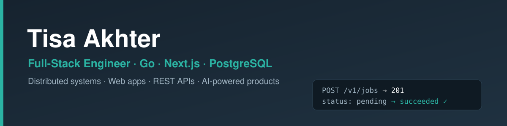

## Hi, I'm Tisa 👋

I'm a **full-stack engineer**. On the backend I build reliable, concurrent systems with **Go, PostgreSQL
and Redis**; on the frontend I ship web apps with **Next.js, React and TypeScript**, and I've taken
AI-powered products from idea to production. I care about software that is **tested, measured, and honest
about its trade-offs**.

## ⭐ Featured work

### [GoFlow](https://github.com/webdomain0126/goflow): distributed job processing engine in Go

A background-job system: jobs come in through a REST API, are stored in PostgreSQL, and are run
concurrently by a pool of workers that can be spread across many machines.

- **Safe concurrent claiming** with `SELECT … FOR UPDATE SKIP LOCKED`: many workers, one queue, no job ever claimed twice (proven by a 20-goroutine race test)
- **Worker pool** with goroutines and channels, leases, heartbeats, crash recovery and graceful shutdown
- **Retries** with exponential backoff and jitter; priorities and scheduled jobs
- **Redis** for instant wake-ups, cross-worker rate limiting and a live worker registry, with graceful fallback when Redis is down
- **120+ tests** (unit, integration, end-to-end) in GitHub Actions CI with the race detector · ~2,900 jobs/sec benchmarked · Docker · Prometheus metrics

**Stack:** Go · PostgreSQL · Redis · Docker · GitHub Actions

### Hungrin: AI restaurant growth platform (client work)

I built the backend for a platform used by UK restaurants: REST API, a MongoDB to PostgreSQL migration,
authentication, a live dashboard, and an AI chat grounded in each restaurant's own data.

**Live:** [hungrin.com](https://hungrin.com)

### More projects

- **[suomen-polku](https://github.com/webdomain0126/suomen-polku)**: Finnish course platform · Next.js 16, TypeScript, Prisma, PostgreSQL, custom JWT auth · [live](https://suomen-polku-app.vercel.app)
- **[snowflake-data-engineering-pipeline](https://github.com/webdomain0126/snowflake-data-engineering-pipeline)**: Python and Snowflake ETL pipeline
- **[crypto-ai-dashboard](https://github.com/webdomain0126/crypto-ai-dashboard)**: AI-powered crypto analytics with live market data
- **[fastapi-flask-crud-journey](https://github.com/webdomain0126/fastapi-flask-crud-journey)**: REST CRUD APIs with FastAPI and Flask

## How I work

- Small, finished and tested beats big and unfinished
- I don't trust a test until I've seen it fail
- Every project gets a real README and an honest list of what it can't do yet

## 🧰 Toolbox

**Backend:** Go · Node.js · Express · FastAPI · Flask · REST APIs

**Data:** PostgreSQL · Redis · Prisma · SQL · MongoDB · Snowflake · pandas

**Frontend:** React · Next.js · TypeScript · Tailwind CSS

**DevOps:** Docker · GitHub Actions · Linux/VPS · Vercel · Neon · Git

## 📫 Contact

[LinkedIn](https://linkedin.com/in/freelancertisa) · webdomain0126@gmail.com
