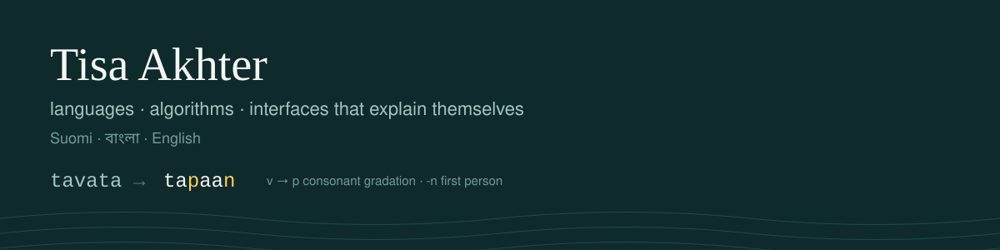

<p align="center">
  
</p>

# Hi, I'm Tisa

I'm a full-stack developer (Next.js, TypeScript, Python, PostgreSQL). I build software where **languages, algorithms and interfaces that explain themselves** meet.

Most of my current work is about teaching Finnish to Bangla speakers, so my projects speak three languages: **Finnish · বাংলা · English**.

---

## Featured work

### 🇫🇮 Suomen Polku: a Finnish course for Bangladeshi learners

A bilingual web course with lessons in Finnish, Bangla and English side by side.

- Localised routes (`/fi/kurssi` ↔ `/en/course`) with next-intl
- Custom auth: bcrypt hashing and signed JWTs in httpOnly cookies
- Per-lesson progress tracking with PostgreSQL (Neon) and Prisma
- Lesson content stored as typed data, with one registry as the source of truth

**Stack:** Next.js · TypeScript · Tailwind CSS · Prisma · PostgreSQL · Vercel
**Code:** [suomen-polku](https://github.com/webdomain0126/suomen-polku) · **Live:** ADD-YOUR-LIVE-LINK

### 🍽️ Hungrin: AI restaurant growth platform (client work)

I built the backend for a platform used by UK restaurants: REST API, a MongoDB to PostgreSQL migration, authentication, live dashboard data, and an AI chat grounded in each restaurant's own data.

**Live:** [hungrin.com](https://hungrin.com)

---

## Building now

### Taivutin: an explainable Finnish verb engine *(in progress)*

Conjugation tables show the answer, not the reason. Taivutin shows every rule as a step, and tells learners *which* rule a wrong answer broke:

```
tavata → tava-    remove -ta
       → tapa-    consonant gradation: v → p (strong grade)
       → tapaa-   add -a
       → tapaan   first person: -n
```

TypeScript, no runtime dependencies, tested against a hand-checked table of real forms. Explanations in Finnish, English and Bangla.

### Small language experiments *(planned)*

- **Finnish in Bangla script:** see how Finnish words sound, written in Bangla letters
- **Vowel harmony playground:** watch a/ä and o/ö endings switch as you type
- **Finnish typing tutor:** practise ä and ö on any keyboard

---

## How I work

- Small, finished and tested beats big and unfinished
- Every project gets a real README, real screenshots and an honest list of what it can't do yet
- Core features work without paid APIs

## Toolbox

**Frontend:** React · Next.js · TypeScript · Tailwind CSS
**Backend:** Node.js · Express · FastAPI · Flask · REST APIs
**Data:** PostgreSQL · Prisma · SQL · MongoDB · pandas
**Other:** NLP workflows · data pipelines · Git · Vercel · Neon

## Contact

[LinkedIn](https://www.linkedin.com/in/freelancertisa/) · [Upwork](https://www.upwork.com/freelancers/~01e0812d2a47505c90) · webdomain0126@gmail.com
